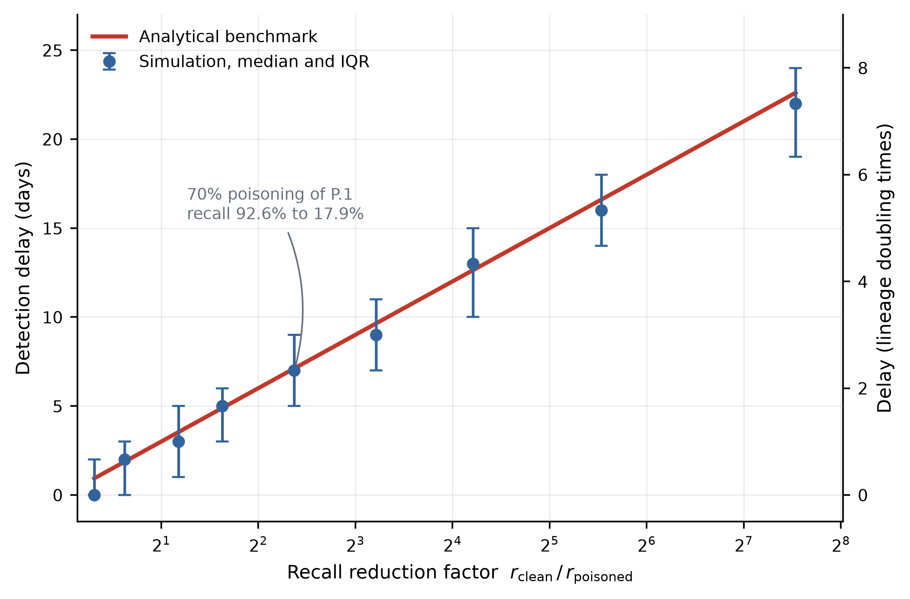

# Surveillance delay under targeted lineage poisoning

Code, cached data and results for estimating how much later an emerging
pathogen lineage is detected when the lineage classifier used by a genomic
surveillance system has been degraded by targeted training-data poisoning.

The analysis has three parts: a closed-form analytical benchmark, a paired
stochastic simulation (identical epidemic and submitted genomes, different
classifier), and a retrospective check of the detection rules on UK BQ.1 data.
Every value in the manuscript's Results section is regenerated by
`reproduce_results.py`.



## Quick start

```
python -m venv .venv && source .venv/bin/activate     # Windows: .venv\Scripts\activate
pip install -r requirements.txt
python reproduce_results.py     # about 1 to 2 minutes; tables, report, two quick figures
python make_figures.py          # the five publication figures (PNG and PDF)
```

No network is needed: both cached weekly series are included, so the
retrospective analysis runs offline. If a cached file is deleted the script
queries the open LAPIS instance (`lapis.cov-spectrum.org`) and re-creates it.

## Files

| File | Purpose |
|---|---|
| `reproduce_results.py` | Self-contained. Regenerates every table and number in the Results section. |
| `make_figures.py` | Draws Figures 1 to 5 from the cached data and simulation output. Imports `reproduce_results.py`. |
| `recall_uncertainty.py` | Propagates sampling error in the recall estimates (88/95 and 17/95) through the analytical expressions. |
| `weekly_BQ_1_submission.csv` | Weekly UK counts indexed by submission date (used for detection) |
| `weekly_BQ_1_collection.csv` | Weekly UK counts indexed by collection date (used for growth estimation) |
| `table_*.csv`, `latex_tables.tex`, `results_report.txt` | Output of the last run, committed for comparison |
| `figures/` | Publication figures, PNG and PDF |
| `requirements.txt` | Dependencies |

## Method in four stages

**1. Epidemic.** A renewal branching process generates true daily incidence of
the emerging lineage. The reproduction number is derived by inverting the
Euler-Lotka equation so that the imposed growth rate is achieved exactly for
the chosen generation-interval distribution.

**2. Sequencing.** A fixed fraction of infections is sequenced and arrives after
a reporting delay. This stage is separate from classification, so both
pipelines receive exactly the same submitted genomes within a replicate.

**3. Classification.** Each genome receives a label drawn from a row of a
confusion matrix. Poisoning enters here and nowhere else. The two pipelines
draw labels independently from their respective matrices.

**4. Detection.** Three rules are applied: `count` (cumulative labelled
sequences reach a threshold), `prevalence` (labelled share above a threshold in
consecutive weeks) and `growth` (binomial logistic regression of the weekly
share, first evaluated after four complete weeks and refitted on all
accumulated weeks). The weekly rules are quantised to 7-day steps.

## Why two cached data files

They are not interchangeable.

**Detection** uses submission dates, because a surveillance system can only act
on sequences that have reached the repository.

**Growth** uses collection dates, because growth is a property of transmission.
The same logistic model gives 0.0513 per day on collection dates and 0.0674 on
submission dates, a difference of about 31% that coincides with pronounced
batching of repository submissions. The script refuses to fit growth on the
submission series.

### Operational lineage availability

Retrospective censoring uses the first date the lineage label was available to
the standard assignment workflow, not the internal designation date. Three
dates are distinguished for BQ.1:

| Event | Date | Source |
|---|---|---|
| Designation committed to `pango-designation` | 2 Sep 2022 | commit `b995eb75` |
| Pango v1.15 released | 3 Oct 2022 | release tag |
| BQ alias available in `pangolin-data` v1.15.1 | 10 Oct 2022 | `alias_key.json`, absent at v1.14 |

The primary analysis censors at 10 October 2022. Using 3 October gives identical
detection dates because no BQ.1 sequences were submitted in the intervening
week (`table_censoring_sensitivity.csv`). Detection error is relative to the
UKHSA designation of 28 October 2022.

## Headline results from the shipped configuration

Emerging lineage P.1, destination B.1.617.2, poisoning of 70% of source-lineage
records. Source-lineage recall falls from 92.60% to 17.90%. Reference growth
0.231 per day (doubling time 3 days), generation interval gamma with mean 3.59
days and coefficient of variation 0.4, derived reproduction number 2.174.

| Rule | Benchmark | Simulated median | IQR | Size ratio | Extra infections |
|---|---|---|---|---|---|
| count | 7.11 d | 7.0 d | 6 to 9 d | 5.21 | 2,420 |
| prevalence | 7.11 d | 7.0 d | 7 to 7 d | 5.00 | 78,301 |
| growth | 7.11 d | 7.0 d | 7 to 7 d | 5.04 | 18,420 |

The analytical size ratio is 5.17. The 7.11-day value is a common benchmark; it
is derived for threshold crossing of counts and prevalence, and agreement of the
growth rule is an empirical simulation result.

At the measured BQ.1 growth rate of 0.0513 per day (doubling time 13.5 days,
reproduction number 1.199) the count rule gives a median delay of 32 days
(IQR 28 to 37) with a size ratio of 5.38. Slower growth lengthens the delay in
days but leaves the multiplicative size penalty close to the analytical factor.

Across the nine-point recall sweep the largest absolute difference between the
simulated median and the analytical benchmark is 0.93 days, with no consistent
direction of deviation.

Retrospective BQ.1 (submission dates, censored at 10 Oct 2022): the count rule
fires in the week beginning 24 Oct 2022 (4 days before the UKHSA designation),
and the prevalence and growth rules in the week beginning 31 Oct (3 days after).
This is a plausibility check of the detection rules on a domestic growth event,
not a validation of the whole simulator.

## Limitations to keep in view

- Weekly rules are quantised to multiples of seven days, so their
  interquartile ranges understate the underlying uncertainty.
- The count rule can fire on background misclassification alone. With
  threshold 5 it did so in 15.6% of 1,000 control replicates over 120 days
  (median day 99) and in 87.0% over 300 days. With threshold 20 no
  background-only detections occurred in 1,000 replicates, consistent with a true
  rate below roughly 0.3% but not establishing zero. Check the threshold against
  the control for every new configuration.
- Confusion matrices are fixed inputs. Their sampling uncertainty is not
  propagated through the simulation; `recall_uncertainty.py` propagates it
  through the analytical expressions only.
- The generation interval is discretised by integrating the gamma density over
  intervals centred on each integer day, with 40-day support.

## Replicates

| Analysis | Replicates |
|---|---|
| Reference configuration | 1,000 |
| Measured growth rate | 500 |
| Each recall-sweep point | 300 |
| Each generation-interval point | 300 |
| Each background-control configuration | 1,000 |

## Reproducibility

All randomness derives from `CONFIG["random_seed"]` (42). Tested from a clean
virtual environment:

- Python 3.12 and 3.13.
- numpy 1.26.4, 2.1.3, 2.2.6, 2.3.5 and 2.4.4 give **byte-identical** output
  tables.
- numpy 2.5 changed its random-number streams. Tables then differ within Monte
  Carlo error (for example the count-rule size ratio is 5.23 rather than 5.21),
  so `requirements.txt` caps numpy below 2.5. Deterministic tables
  (analytical, retrospective) are identical on every version.

## Applying it to another lineage

Edit the `RETRO` block and the date constants in `reproduce_results.py`
(country, target lineage, date window, growth window, assignable date). Assess
detection on submission dates, fit growth on collection dates, and censor at the
date the label was operationally assignable. First release dates from
`cov-lineages/pango-designation` bound but do not equal assignable dates:

| Lineage | First release | Date |
|---|---|---|
| BA.1 | v1.2.106 | 2021-12-07 |
| BA.5 | v1.3 | 2022-04-06 |
| BQ.1 | v1.15 | 2022-10-03 |
| XBB.1.5 | v1.17 | 2022-12-05 |

## Data

Weekly counts come from the open CoV-Spectrum LAPIS instance, which is derived
from public GenBank records. Pango lineage and release dates are from the
`cov-lineages` repositories. The confusion matrices used as classifier inputs
are documented in Supplementary S1 of the manuscript.

## Citation and licence

See `CITATION.cff`. Code is released under the MIT licence (`LICENSE`). The
manuscript citation and a data DOI will be added here once available.
